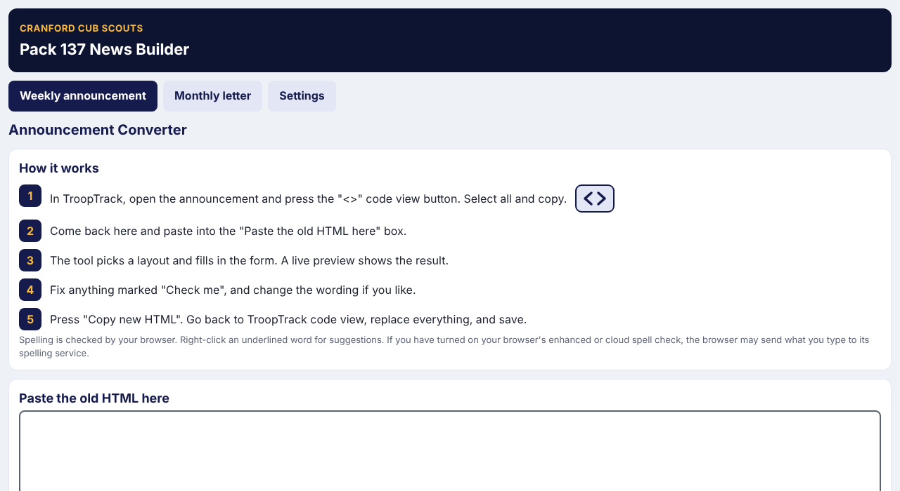
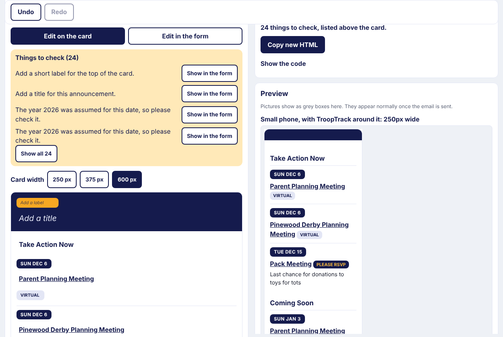
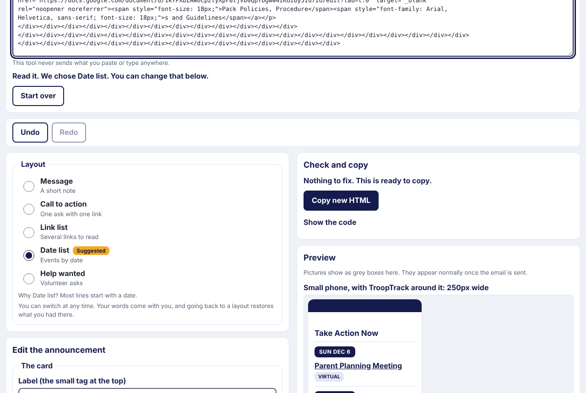
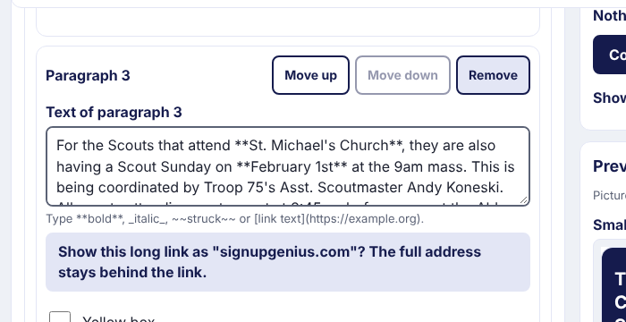
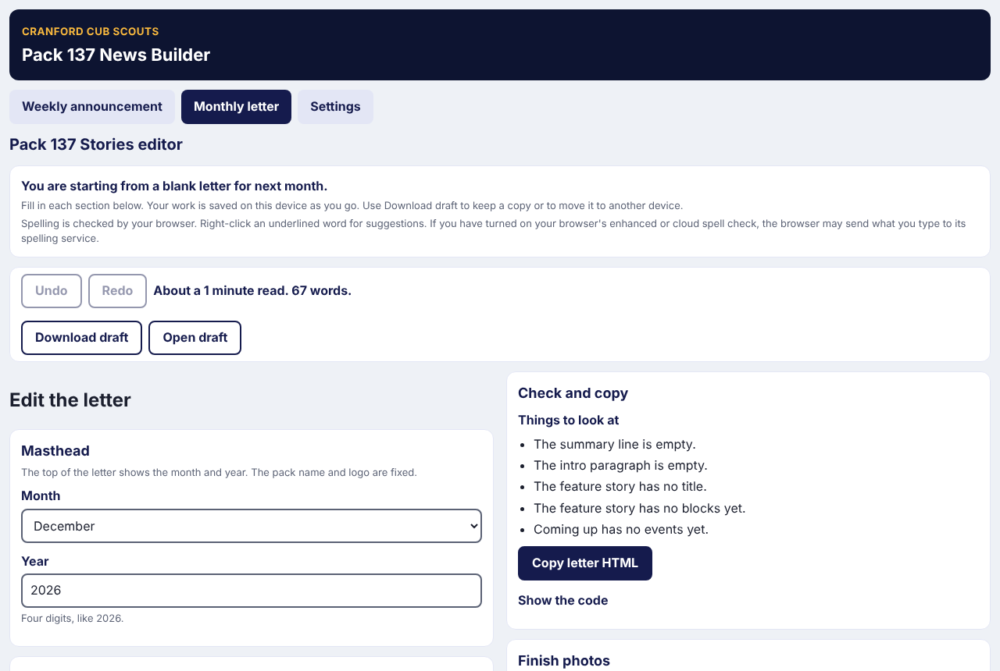

# Pack 137 News Builder: user guide

This guide shows you how to use the News Builder. You do not need to know HTML. HTML is the code that TroopTrack uses for its emails. You copy code out of TroopTrack, change it here, and copy it back in.

## What the tool does

The News Builder does two jobs.

1. It turns a TroopTrack announcement into the pack's email style.
2. It builds the monthly "Pack 137 Stories" letter.

Nothing you paste or type leaves your device. The tool works without the internet.

## Weekly announcement

1. In TroopTrack, open the announcement.
2. Press the `<>` code view button.
3. Select all the code, then copy it. On a Mac, use Command instead of Ctrl.
4. Go back to the News Builder. Paste into the box marked "Paste the old HTML here".

The tool picks one of five layouts and fills it in for you. The five layouts are Message, Call to action, Link list, Date list and Help wanted. You can switch layout at any time. Your words come with you.

### Edit on the card, or in the form

After you paste, the tool shows "Edit on the card": your announcement drawn the way the email will look.

- Click any words on the card and type to change them.
- To make words bold, italic or crossed out, or to make them a link, select them and press Bold, Italic, Strike or Link. You can also press Ctrl+B, Ctrl+I or Ctrl+K (Command on a Mac). For Bold, Italic or Strike you can also press the button first with nothing selected, then type: the words you type next are formatted. Moving the cursor or clicking somewhere else cancels this. A link needs words, so select them first.
- The buttons appear directly under the line you are editing. They push the lines below down a little and never cover any text. Press Tab to reach them from the line, and Shift+Tab to come back.
- Things the card cannot change, such as dates, link addresses, button colors or adding a row, are in the form. Click into a row to see its "Change in the form" button. Each section also has one.
- "Things to check" above the card lists anything to look at. Each item has a button that takes you to it. While you are on the card, the "Check and copy" panel on the right only says how many there are, such as "3 things to check, listed above the card." In the form, that panel shows the full list.

The switch at the top, "Edit on the card" or "Edit in the form", moves between the two. Both change the same announcement, so you lose nothing by switching. The tool remembers your choice on this device, for the monthly letter too.

In the form, text boxes also have the Bold, Italic, Strike and Link buttons. If you prefer typing codes such as `**bold**` and `[link text](https://...)`, tick "Show codes" at the top of the form.

5. Fix anything marked "Check me".
6. Look at the one-tap suggestions, if any appear. They may suggest:
   - Sentence case for a heading written in Title Case.
   - Showing a long web address as the site's name, such as "signupgenius.com".
   - Small fixes, such as "and" in place of "&".

Suggestions are never applied unless you tap them. If you tap one by mistake, press Undo.

7. Style choices are optional. Use them for the one thing people must not miss.
   - Under a paragraph in Message or Call to action, tick "Yellow box". The paragraph sits in a pale-yellow box.
   - Set "Button color" to Gold for a gold button.
8. Look at the preview. It shows three sizes: a small phone (320 pixels wide), a phone (375) and a desktop (600). Photos show as grey boxes in the preview only.
9. Press "Copy new HTML".
10. In TroopTrack code view, delete the old code. Paste the new code. Save.

If the Copy button does not work, the code appears in a box. Click in the box. Press Ctrl+A, then Ctrl+C. On a Mac, use Command+A, then Command+C.

### Date list

When you switch to Date list, dates written inside sentences become rows. The rows are sorted by date.

- Each date shows as a navy label, such as SUN FEB 1.
- A date in the title is flagged. You can shorten the title if you want.
- Check the year shown. The tool assumes the next time that date comes round.

## Monthly letter

1. Press "Monthly letter" at the top of the screen.
2. Fill in each section. The letter opens on the card too: click any words to change them. Use "Change in the form" for dates, links, photos and adding or moving blocks.
3. The "Things to check" list names anything still missing. On the card it is above the card, and the Check and copy panel on the right gives the number. In the form it is in the Check and copy panel. It never stops you copying.
4. The read time updates as you type.
5. Your work saves as you go, in this browser or app only. The website and an unzipped copy of the tool keep separate saved work. To carry on somewhere else, use Download draft. The screen says this next to "Saved on this device".
6. Press "Copy letter HTML". Paste into TroopTrack code view, the same way as an announcement.

### Photos in the letter

TroopTrack holds the photos, so add them there. Follow these steps.

1. Add a Photo block, or turn on the photo in a Sidebar box.
2. Type a description. Say what the photo shows. Do not name a child.
3. If the photo file is large, press "Shrink a photo for the letter" before you upload it. The tool saves a smaller copy in your Downloads folder. It is a JPEG, at most 1104 pixels wide, about 300 KB, with the location removed.
4. Press "Copy letter HTML" and paste it into TroopTrack. The letter leaves an "Insert photo here" spot for each photo.
5. In TroopTrack, replace each spot with its photo. Use TroopTrack's image button.
6. Copy TroopTrack's code. Paste it into the "Finish photos" box on this screen. Press "Copy finished HTML".
7. Paste that code back into TroopTrack.

Finish photos adds the descriptions and makes the photos fit phone screens.

### Save and reopen a letter

- Download draft saves a `.json` copy of your letter into your Downloads folder. Keep it.
- Open draft opens a `.json` copy. You can open it on any device.
- When you come back, you can keep working, start next month from this one, or start a blank letter.

## Settings

The logo, footer links, pack emails, photo form link and program year start are on the Settings tab. They are saved on this device. To put the original Pack 137 settings back, press "Restore Pack 137 defaults".

## Undo and Redo

- On screen, use the Undo and Redo buttons.
- On a keyboard, press Ctrl+Z to undo. Press Ctrl+Shift+Z or Ctrl+Y to redo. On a Mac, use Command.

## Getting the tool

There are three versions. Pick the one that suits you.

- Web zip: unzip the file, then open `index.html`. Mac users use this version, in Safari.
- Windows app: the file that ends in `.exe`.
- Android app: the file that ends in `.apk`.

For install steps and warnings, read [Using the web build](using-the-web-build.md) and [Installing the desktop app](installing-the-desktop-app.md).

## Saved work and privacy

- Your work is saved in the browser or app on that device only.
- A different browser, or the app, does not see that work.
- Clearing your browser's data removes saved work.
- Keep a Download draft copy of each monthly letter.

## If something looks wrong

1. Check that you are on the same device and in the same browser or app.
2. If you have a draft file, press Open draft and choose it.
3. If you are still stuck, ask the project owner.
